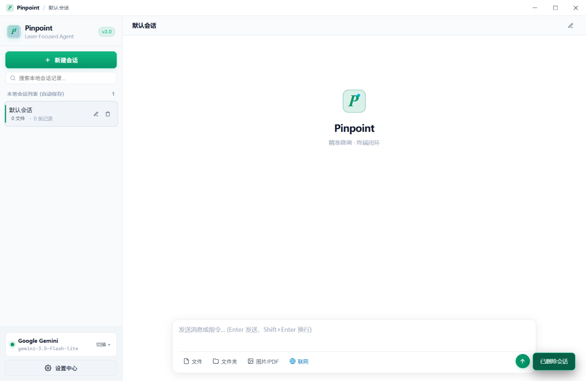
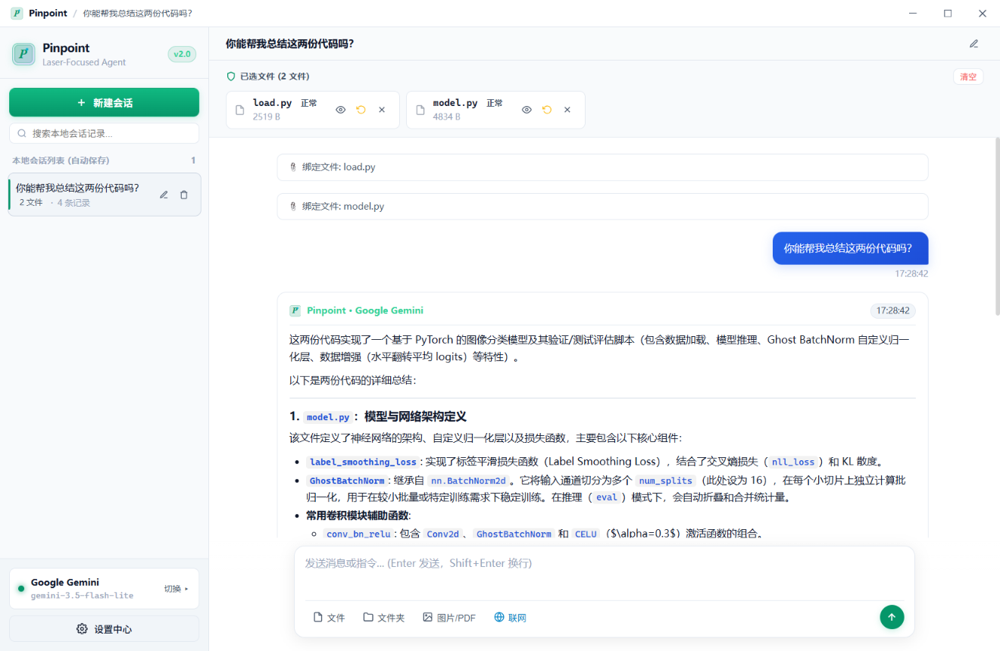

# Metis 🎯

<div align="center">
  
  <br/>
  <h3> Metis Agent </h3>
  <p><b>File-Centric Mini Coding Agent with Zero Blast Radius</b></p>

  [](https://microsoft.com)
  [](https://dotnet.microsoft.com)
  [](LICENSE)
</div>

---

## 🖼️ Interface Preview / Screenshots

<div align="center">
  <p><b>Clean, minimalist workspace and file management</b></p>
  
  <br/><br/>
  <p><b>Laser-focused file modification and streaming chat interaction</b></p>
  
</div>

---

## 💡 Philosophy & Design

> **"Why scan and re-index an entire repository when you only need to fix a single bug?"**

In an era where AI coding assistants promise "autonomous full-stack repository generation", real-world developers often encounter:
* **High Blast Radius**: Unchecked full-repo agents frequently rearrange directories, overwrite dependencies, or introduce breaking structural changes without warning;
* **Context Dilution**: Cramming entire monorepos into LLM context windows causes severe token waste, slow responses, and hallucinated modifications.

**Metis is built on the philosophy of "Laser Focus, Zero Blast Radius":**
* **Laser Focus**: Only files or directories you explicitly drag in or select are admitted into the prompt context. No uninvited background file crawling.
* **Zero Blast Radius**: **Creating new files is strictly forbidden. Deleting existing files is strictly forbidden.** Metis operates exclusively by surgically modifying existing whitelisted files in-place using Search/Replace blocks.
* **Autonomous Live Web Search**: Metis can autonomously query public technical documentation, API specifications, and troubleshooting guides in real time.

---

## ✨ Key Features

### 1. 📂 Explicit File Management & Directory Trees
* Support for individual file drag-and-drop or selection, as well as **recursive directory uploading**.
* Built-in file snapshots with one-click historical version rollback.

### 2. 🌐 Live Web Search
* When modern API documentation, framework specifications, or troubleshooting guides are required, Metis emits `<metis_search>` tags to fetch and summarize web content automatically.
* Search results are seamlessly fed back into the reasoning context and rendered as rich cards in the UI.

### 3. 🛡️ Strict Prohibition on File Creation & Deletion
* Triply enforced across the prompt instruction protocol, the file management layer, and the local terminal verification engine.
* Any command attempting to delete files (`rm`, `del`, `Remove-Item`) or create unauthorized scripts is intercepted and blocked immediately.

### 4. 🖼️ Native Multimodal Support (PDF & Images)
* **PDF Document Multimodal Pipeline**: Direct Base64 streaming of PDF documents to supported models for cross-page architecture and requirement analysis.
* **Visual Understanding**: Direct inspection of architecture diagrams, UI mockups, and terminal error screenshots in PNG, JPG, or WEBP formats (compatible with OpenAI, Claude, Gemini, DeepSeek, etc.).

### 5. 🎨 Minimalist Aesthetic & Dark/Light Themes
* Distraction-free modern interface with mist-dissolving text animations, fluid streaming, and full KaTeX mathematical typesetting.
* Seamless switching between **Dark Mode** and **Light Mode**.

### 6. 🔌 Multi-Vendor Direct API Connectivity
* Native zero-proxy support for **DeepSeek**, **OpenAI**, **Anthropic Claude**, **Google Gemini**, **Kimi / Moonshot**, **Zhipu GLM**, and local **Ollama** models.

---

## 🖥️ Quick Start

### Option A: Portable Standalone (No Installation Required)
Double-click **`Metis.exe`** directly from the root directory. Zero footprint, instant launch.

### Option B: Windows Setup Wizard
Run **`Metis-Setup.exe`**:
* Installs cleanly to `%LOCALAPPDATA%\Programs\Metis`;
* Creates desktop and Start Menu shortcuts with full uninstaller support.

---

## 🛠️ Configuration & Workflow

1. **Configure Your API Key**:
   * Click **⚙️ Settings** in the bottom-left corner;
   * Select your preferred LLM provider (e.g., DeepSeek, OpenAI, Claude, or Gemini), enter your `Base URL`, `API Key`, and `Model Name`;
   * Click "Save Settings" (persisted securely in local `%APPDATA%\Metis\config.json`, never uploaded to third parties).

2. **Select Target Files**:
   * In the workspace panel, click "Add File" or "Upload Folder" to scope down the exact files requiring modification.

3. **Request Surgical Edits**:
   * Enter your prompt in the chat composer, for example:
     > *"Add token expiration retry handling to auth.py, update the test suite in test_auth.py, and run python -m unittest to verify."*
   * Metis will reason, propose surgical Search/Replace edits, and invoke the terminal to run tests until validation succeeds.

---

## 🔨 Building from Source

Metis is implemented in pure native C# (.NET Framework 4.8 + WebView2) with zero heavy package manager dependencies. It compiles instantly using the Windows built-in C# compiler:

```cmd
# Clone or navigate to the repository
cd metis

# Run the build script (produces Metis.exe and Metis-Setup.exe)
build.bat
```

> **Prerequisites**:
> * Windows 10 / Windows 11 (x64)
> * .NET Framework 4.8 (pre-installed on Windows 10/11)
> * Microsoft Edge WebView2 Runtime (pre-installed on Windows 11, or installed via Microsoft Edge)

---

## 📂 Project Structure

```text
├── assets/
│   ├── metis-icon.png          # High-resolution application logo
│   ├── pic1.png                # Main workspace interface preview
│   └── pic2.png                # Conversational micro-editing preview
├── src/
│   ├── Metis.ico               # Multi-resolution Windows application icon
│   ├── Models.cs               # Domain models (Sessions, Config, Whitelist, Event stream)
│   ├── ConfigManager.cs        # Local persistent configuration and smooth migration
│   ├── WhitelistManager.cs     # File whitelist, Search/Replace engine, and system prompt generator
│   ├── VerificationRunner.cs   # Safe terminal process runner and destruction blocker
│   ├── WebSearchRunner.cs      # Live autonomous web search engine
│   ├── MultiVendorClient.cs    # Multi-vendor streaming LLM client with backoff retry
│   ├── MediaAttachmentHelper.cs# Base64 multimodal pipeline (PDF & image parsing)
│   ├── MainWindow.cs           # Native WPF + WebView2 dual-binding host window
│   ├── Program.cs              # Entry point and headless automated verification test suite
│   ├── Installer.cs            # Standalone lightweight Windows installer wizard
│   └── frontend/
│       └── app.html            # Modern responsive UI (Dark/Light themes, syntax highlighting, KaTeX)
├── lib/
│   └── webview2/               # Embedded WebView2 runtime binaries
├── build.bat                   # One-click standalone compilation script
├── .gitignore                  # Git ignore rules
└── README.md                   # Project documentation and architectural guide
```

<div align="center">
  <sub>Metis · Surgical precision for the code that matters most.</sub>
</div>
