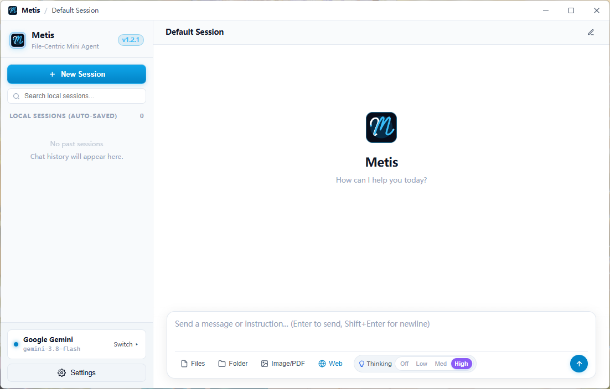

# Metis 🎯

<div align="center">
  
  <br/>
  <h3> Metis Agent </h3>
  <p><b>Laser-Focused, File-Centric Micro Coding Agent with Zero Blast Radius</b></p>

  [](https://github.com/Sakiko236/Metis)
  [](https://tauri.app)
  [](https://python.org)
  [](LICENSE)
</div>

---

## 🖼️ Interface Preview

<div align="center">
  <p><b>Clean, minimalist workspace and file management with zero clutter</b></p>
  
</div>

---

## 💡 Philosophy & Design

> **"Why scan and re-index an entire repository when you only need to fix a single bug?"**

In an era where AI coding assistants promise "autonomous full-stack repository generation", real-world developers often encounter:
* **High Blast Radius**: Unchecked full-repo agents frequently rearrange directories, overwrite dependencies, or introduce breaking structural changes without warning.
* **Context Dilution**: Cramming entire monorepos into LLM context windows causes severe token waste, slow responses, and hallucinated modifications.

**Metis is built on the philosophy of "Laser Focus, Zero Blast Radius":**
* **Laser Focus**: Only files or directories you explicitly drag in or select are admitted into the prompt context. No uninvited background file crawling.
* **Zero Blast Radius**: **Creating new files is strictly forbidden. Deleting existing files is strictly forbidden.** Metis operates exclusively by surgically modifying existing whitelisted files in-place using exact Search/Replace blocks or initial population.
* **Autonomous Live Web Search**: Metis autonomously queries public technical documentation, API specifications, and troubleshooting guides in real time via DuckDuckGo.

---

## 🏗️ Architecture: Tauri 2.0 + Python Sidecar

Metis combines the best of both desktop performance and AI ecosystem agility through a decoupled **Tauri 2.0 Host + Python Sidecar Engine** architecture:

```mermaid
flowchart TD
    subgraph Frontend["Frontend UI (HTML5 / CSS3 / Vanilla JS)"]
        UI["Chat & Workspace Interface (index.html)"]
    end

    subgraph Tauri_Host["Desktop Host (Tauri 2.0 / Rust)"]
        Window["Frameless Window Controls & Tray"]
        Dialogs["Native OS File / Folder Dialogs (rfd)"]
        Supervisor["Sidecar Process Lifecycle Supervisor\n(Auto-launches & kills child process, zero zombies)"]
    end

    subgraph Py_Sidecar["Business & AI Engine (Python 3.10+)"]
        IPC["Asynchronous JSON-Lines Pipe (METIS_IPC)"]
        Agent["Autonomous Agent Loop & Thinking Parser"]
        LLM["Multi-Vendor Client (Gemini 2.5, Claude, OpenAI, DeepSeek, Ollama)"]
        Tools["Surgical In-Place Editor | Shell Runner | Web Search"]
        Storage["Cross-Platform Config & Session Persistence"]
    end

    Window -->|Render Native Shell| UI
    UI <-->|Tauri IPC Invoke / Events| Tauri_Host
    Supervisor -->|Standard I/O Pipes (stdin / stdout)| IPC
    IPC <--> Agent
    Agent --> LLM
    Agent --> Tools
    Agent --> Storage
```

* **Desktop Host (Rust / Tauri 2.0)**:
  - Manages frameless window controls (minimize, maximize/restore, drag, close), system tray, and native OS file/directory pickers.
  - Acts as a resilient supervisor: launches the Python Sidecar with standard I/O pipes (no open TCP ports, no firewall popups) and automatically terminates child processes on exit to guarantee **zero zombie processes**.
* **Core Business Engine (`src-python/`)**:
  - Implements the complete autonomous agent loop, multi-vendor streaming LLM client, surgical Search/Replace engine, terminal command execution, and DuckDuckGo web search.
  - Freezes into a standalone native binary (`metis-engine`) using PyInstaller, bundled directly inside Tauri installers so **end users do not need Python installed**.

---

## ✨ Key Features

### 1. 📂 Explicit Whitelist & In-Place Surgical Editing
* Support for individual file drag-and-drop or selection, as well as **recursive directory mounting**.
* **Zero Blast Radius**: Modifies existing whitelisted files in-place using precise 3-tier Search/Replace blocks (exact, normalized CRLF/LF, line-by-line whitespace-trimmed), with automatic support for populating empty 0-byte files.
* Built-in file snapshots with one-click historical version rollback.

### 2. 🧠 Gemini 2.5 Thinking Budget & Extended Reasoning
* Comprehensive support for Google Gemini 2.5 Thinking configurations (`thinkingBudget`: `low` = 2048, `medium` = 8192, `high` = 24576).
* Real-time streaming parser extracts `thought` parts dynamically, rendering breathing animation placeholders without polluting generated code.
* Automatic fallback protection for legacy models without thinking support.

### 3. 🌐 Autonomous Live Web Search
* When modern API documentation, framework specifications, or troubleshooting guides are required, Metis emits `<metis_search>` tags to query DuckDuckGo automatically.
* Search results are seamlessly fed back into the reasoning context and rendered as rich cards in the UI.

### 4. 🛡️ Strict Prohibition on File Creation & Deletion
* Enforced across the prompt protocol, the Python whitelist guardrails, and the terminal runner.
* Any command attempting to delete files (`rm`, `del`, `Remove-Item`) or create unauthorized scripts is intercepted and blocked immediately.

### 5. 🎨 Responsive Minimalist UI & Dark/Light Themes
* Distraction-free modern interface with mist-dissolving text animations, uncapped full-width responsive dialog bubbles and composer, and KaTeX mathematical typesetting.
* Seamless switching between **Dark Mode** and **Light Mode**.
* System default browser integration for all external links.

### 6. 🔌 Multi-Vendor Direct API Connectivity
* Native zero-proxy support for:
  - **Google Gemini** (`gemini-2.5-flash`, `gemini-2.5-pro`, `gemini-2.0-flash`, `gemini-1.5-pro`)
  - **DeepSeek** (`deepseek-chat`, `deepseek-reasoner`)
  - **OpenAI** (`gpt-4o`, `gpt-4o-mini`, `o3-mini`, `gpt-4.5-preview`)
  - **Anthropic Claude** (`claude-3-7-sonnet`, `claude-3-5-sonnet`, `claude-3-5-haiku`)
  - **Local Ollama** models with one-click model probing
  - **Custom OpenAI-compatible** endpoints

---

## 🖥️ Quick Start & Downloads

Download the appropriate release package for your operating system from the [Releases](https://github.com/Sakiko236/Metis/releases) page:

* **🪟 Windows**:
  * **Installer**: `Metis_<version>_x64-setup.exe` (NSIS installer with bundled standalone Python engine & clean uninstaller)
* **🍎 macOS**:
  * **Apple Silicon (M1/M2/M3/M4)**: `Metis_<version>_aarch64.dmg`
* **🐧 Linux**:
  * **Debian / Ubuntu**: `metis_<version>_amd64.deb`
  * **Universal Linux**: `Metis_<version>_amd64.AppImage`

---

## 🛠️ Configuration & Workflow

1. **Configure Your API Key**:
   * Click **⚙️ Settings** in the bottom-left corner;
   * Select your preferred LLM provider (e.g., Gemini, DeepSeek, OpenAI, or Claude), enter your `Base URL`, `API Key`, and `Model Name`;
   * Settings automatically save locally as you type (stored locally on your system, never uploaded to third parties).

2. **Select Target Files**:
   * In the workspace panel, click "Add File" or "Upload Folder" to scope down the exact files requiring modification.

3. **Request Surgical Edits**:
   * Enter your prompt in the chat composer, for example:
     > *"Add token expiration retry handling to auth.py, update the test suite in test_auth.py, and run python -m unittest to verify."*
   * Metis will reason, propose surgical Search/Replace edits, and invoke the terminal to run tests until validation succeeds.

---

## 🔨 Building from Source

### Prerequisites
* [Node.js](https://nodejs.org/) (LTS)
* [Rust](https://rustup.rs/) (Stable toolchain)
* [Python](https://python.org/) (3.10+)
* Platform Webview:
  * Windows: Microsoft Edge WebView2 (built-in on Windows 10/11)
  * macOS: WebKit (built-in)
  * Linux: `libwebkit2gtk-4.1-dev` (`sudo apt-get install -y libwebkit2gtk-4.1-dev build-essential`)

### Development Mode

In development mode, Tauri automatically resolves and runs `src-python/main.py` directly, allowing instant hot-reloading when editing Python code without needing to recompile:

```bash
# Clone the repository
git clone https://github.com/Sakiko236/Metis.git
cd Metis

# Install frontend dependencies
npm install

# Install Python sidecar requirements
python -m pip install -r src-python/requirements.txt

# Run the application in development mode
npm run tauri dev
```

### Production Packaging

To compile the Python engine into a standalone binary and bundle it into native installers:

```bash
# 1. Package the Python Sidecar into src-tauri/bin/
python scripts/build_sidecar.py

# 2. Build the production Tauri installer
npm run tauri build
```

### Headless Verification

You can run automated self-test suites to verify all features end-to-end:

```bash
# Test the Python Sidecar engine directly:
python src-python/main.py --self-test

# Test the Tauri Host <-> Python Sidecar IPC bridge end-to-end:
cargo run --manifest-path src-tauri/Cargo.toml -- --self-test
```

---

## 📂 Project Structure

```text
├── assets/
│   ├── metis-icon.png          # High-resolution application logo
│   └── firstpage.png           # Main workspace interface preview
├── demo_workspace/             # Sample workspace files for quick testing
├── scripts/
│   └── build_sidecar.py        # PyInstaller build script for Tauri externalBin
├── src/
│   └── frontend/
│       └── index.html          # Modern responsive UI (Sky Blue theme, KaTeX, uncapped width)
├── src-python/                 # Core Python Sidecar Business Engine
│   ├── main.py                 # Async IPC loop, CLI self-test runner, and agent orchestrator
│   ├── agent.py                # AgentController state & AgentLoop prompt builder
│   ├── config.py               # Cross-platform config persistence & model memory
│   ├── llm.py                  # Multi-vendor streaming client (Gemini, Claude, OpenAI, DeepSeek)
│   ├── models.py               # Data domain models & PascalCase serialization schemas
│   ├── requirements.txt        # Python build dependencies (PyInstaller)
│   ├── search.py               # Autonomous DuckDuckGo live web search scraper
│   ├── session.py              # Cross-platform chat session store
│   ├── shell.py                # Silent cross-platform terminal command runner
│   └── whitelist.py            # Zero-blast-radius file guardrails & surgical editor
├── src-tauri/                  # Tauri 2.0 Native Shell Host
│   ├── Cargo.toml              # Rust crate manifest (minimal lightweight shell)
│   ├── tauri.conf.json         # Tauri 2.0 app, window, and externalBin configuration
│   ├── build.rs                # Universal cross-platform build script
│   ├── icons/                  # Multi-resolution application icons (ICO, ICNS, PNG)
│   ├── capabilities/           # Tauri 2.0 security capabilities
│   └── src/
│       ├── main.rs             # Desktop launcher & end-to-end headless self-test runner
│       └── lib.rs              # SidecarBridge supervisor, window controls, and IPC bridge
├── .github/workflows/
│   └── release.yml             # Automated multi-platform CI/CD release workflow
├── package.json                # Project root manifest & Tauri CLI scripts
├── metis_config.example.json   # Sample configuration file
├── .gitignore                  # Git ignore rules
├── RELEASE_NOTES.md            # Version release notes
└── README.md                   # Project documentation and architectural guide
```

---

<div align="center">
  <sub>Metis · Surgical precision for the code that matters most.</sub>
</div>
