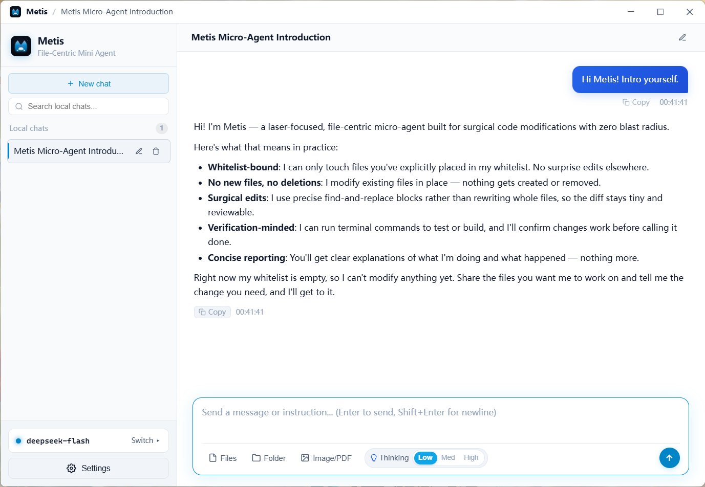

  
   
  <h3> Metis Agent </h3>
  
<b>File-Centric Micro Coding Agent</b>

  
  
  
  

---

## 🖼️ Interface Preview

  
<b>Clean, minimalist workspace and file management</b>

  

---

## 💡 Philosophy & Design

> **This could be the most useless agent in the world, but I like it.**

I love using web chat interfaces for LLMs because I really enjoy solving problems through conversation. The only drawback is that I have to manually upload and download code every time. However, I’m not really into heavy harnesses either—they just end up making me feel foolish.

---

## ✨ Key Features

Technically speaking, it's pretty much just a chat LLM that can modify local files, but with full ReAct capabilities under the hood. After some thought, I decided to drop terminal execution support in v1.5.0. If you still need command-line execution, though, feel free to grab v1.4.12.

Another mind-blowing detail: because I built the UI with Rust, it’s ridiculously small. The installer and memory footprint are both around just **10MB**! It also launches in the blink of an eye.

## 🖥️ Quick Start & Downloads

Download the appropriate release package for your operating system from the [Releases](https://github.com/Sakiko236/Metis/releases) page:

* **🪟 Windows**:
  * **Installer**: `Metis_<version>_x64-setup.exe` (NSIS installer with bundled standalone Python engine & clean uninstaller)
* **🍎 macOS**:
  * **Apple Silicon (M1/M2/M3/M4)**: `Metis_<version>_aarch64.dmg`
* **🐧 Linux**:
  * **Debian / Ubuntu**: `metis_<version>_amd64.deb`
  * **Universal Linux**: `Metis_<version>_amd64.AppImage`

---

  Metis · 2026

